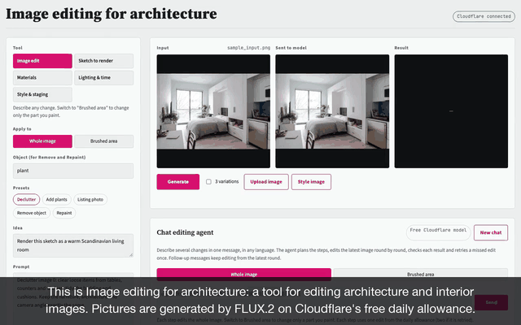

# ArchEdit

Image editing for architecture and interiors. Turn a sketch into a render, swap materials on a brushed surface, relight a room, or restyle and stage it, while the building's geometry and camera stay put. Images are generated with FLUX.2 on Cloudflare Workers AI's free daily allowance, so no GPU is needed. Claude can write the prompt for you (optional).

[](docs/tutorial/archedit-tutorial.mp4)

*Plays on its own, without sound. Click it for the full video with English voice-over (2 min). It is recorded from the real app by `docs/tutorial/make_tutorial.py` (Playwright + macOS voice), so it can be re-recorded after UI changes.*

## Tools

| Tool | What it does | How |
|---|---|---|
| **Image edit** | Any change in words: remove or repaint an object, add plants, declutter, polish as a listing photo | Whole image, or switch to **Brushed area** to change only what you paint |
| **Sketch to render** | Line drawing or sketch → photorealistic render | The drawing is sent as-is (or a photo is traced into line art first) |
| **Materials** | Brush a surface, pick what it is (wall, floor, ceiling…) and a material (brick, concrete, oak, marble…) | Crop around the brush, edit the crop, paste back through a feathered mask: pixels outside the brush never change |
| **Lighting & time** | Golden hour, blue hour, night, overcast, snow | Whole-image edit that keeps geometry and camera |
| **Style & staging** | Japandi, Scandinavian, industrial, mid-century, virtual staging | Whole-image edit that keeps walls, windows and camera |

Each tool has presets with prompts written for that job. Two lessons from testing with real edits:
- A vague target makes the model pick its own. "Replace the surface" bricked the rug instead of the wall, and "remove the object" left the plant in place. Presets that act on a brushed area therefore always name the target (wall, floor, plant…).
- Say what should be there instead. "Remove the plant" alone often came back unchanged on klein 4B; "remove it and show the empty wall and cabinet behind it" worked.

## Multi-round editing

Every result becomes the input of the next round, so edits stack: brick wall → blue hour → declutter. The **Rounds** timeline shows each step; **Undo**, **Redo** and **Original** move through it, and editing from an earlier round branches (later rounds are replaced). Uploading a new image starts a new session.

**3 variations** runs the same edit with three consecutive seeds in parallel (about the time of one) and shows them side by side; the first becomes the round, and picking another swaps it in. The daily allowance is reserved for the whole batch up front, so a batch never stops halfway, and if one variation fails the others are still shown. **Before / after** compares the current round with the original or the previous round on a draggable slider.

Two details make rounds hold up:
- **Size defaults to "Match input"** (≈1 MP in the input's aspect ratio). A fixed size cropped the photo a bit more every round; in testing, a square output cut off the brick wall added the round before.
- **Brushed-area rounds are pixel-exact outside the brush**, so they don't degrade the rest of the image. Whole-image rounds (lighting, style) redraw the scene from a reference image capped at 504 px by Cloudflare, so fine detail can drift; doing whole-image changes first and brushed changes after keeps the result sharpest.

## Chat editing agent (LangGraph)

Type several changes in one message, in any language ("把床後面的牆改成紅磚，再換成藍調時刻，最後整理桌面"), and the agent runs them as rounds:

```
plan ─► edit ─► check ─► accept ─► edit (next step) … ─► finish
          ▲        │
          └────────┘ missed edit: retry once with a rewritten prompt
```

- **plan** splits the message into up to 4 steps and writes a FLUX.2 prompt for each, modelled on the tool presets (short prompts such as "change the lighting to blue hour" tinted the whole picture blue in testing).
- **edit** runs one edit on the latest image (whole image, or only the brushed area). Each accepted step becomes a round in the Rounds timeline, so Undo, branching and Before / after work as usual.
- **check** shows a vision model BEFORE | AFTER side by side and asks three yes/no questions: is the change visible, are the colors natural, is it the same scene. All three must pass; otherwise the step is retried once with the reviewer's prompt and then accepted anyway with a warning, so a run never loops.
- **Memory**: a LangGraph checkpointer keeps each chat thread, so a follow-up ("now add two large plants") knows what came before and edits the current round. **New chat** or uploading a new image starts a new thread. Threads are per visitor and kept in memory (the oldest 200 are forgotten first).

**Brushed area**: switch the chat to *Brushed area* (the same switch as the tools' *Apply to*) and paint on the input image. Every step then runs like Materials: FLUX.2 sees only a crop around the area and the result is pasted back through a feathered mask, so pixels outside the area stay identical. The planner sees the area tinted red so it knows what was selected, the check compares close-up crops, and the area is kept for follow-up messages ("make the veining thinner"). Lighting and style changes need *Whole image*; the agent says so instead of trying.

The planner and reviewer are Claude when `ANTHROPIC_API_KEY` is set, otherwise Llama 4 Scout on Cloudflare Workers AI (free, about 20 Neurons per call, a fifth of one klein-4B image). Set `AGENT_BRAIN` to `claude`, `cloudflare` or `off` to choose, and `AGENT_REVIEW=0` to skip the check (one image per step, never retried). Each step uses one edit from the daily allowance, two when retried.

## Drift guard

Whole-image rounds are redrawn from a reference capped at 504 px, and in testing each one came back about 1-2% zoomed and shifted 3-13 px (restyles up to 9%), which adds up over several rounds. After every whole-image round (manual or agent) `app/align.py` registers the result back onto its input:

1. SIFT features + RANSAC give a similarity transform (works through big changes).
2. ECC refines it on gradient images; ECC ignores brightness and contrast, so it still locks on after a relighting, when SIFT finds only a handful of matches.
3. If the fit is reliable (edge correlation improves, scale within 12%, shift within 8%) and the drift is over a pixel, the result is warped back. The UI shows it, e.g. "drift fixed 13px (1.4% zoom)". Set `ALIGN_ROUNDS=0` to turn it off.

## Camera-move video (2.5D novel view synthesis)

**Camera-move video** turns the current round into a short MP4 with a virtual camera move: **Push in**, **Pan** or **Orbit**, 3 to 6 seconds.

1. [Depth Anything V2 Small](https://huggingface.co/onnx-community/depth-anything-v2-small) (ONNX, Apache-2.0) estimates per-pixel depth on the CPU (about 0.6 s). The ~99 MB model is downloaded into `models/` on first use. Pixels on a depth edge are snapped to the near or far side, so no "flying pixels" float between an object and the floor.
2. Every pixel becomes a 3D point. For each frame the camera moves and the points are splatted forward with a z-buffer (`np.minimum.at`), so near objects always cover far ones; each point also covers its right, lower and diagonal neighbour to close 1 px cracks.
3. Frames are encoded as H.264 / yuv420p MP4 with the ffmpeg bundled in `imageio-ffmpeg`, which every browser plays.

Without fill it is free (about 5 s for 4 s of video) and the moves stay small, since nothing hidden behind objects is invented.

**Bigger move, fill revealed areas with FLUX** (prior-based view synthesis) doubles the move. The renderer finds the one or two poses that reveal the most hidden area, stretches the farther surface into those holes as a first guess (the floor behind a chair, not the chair's colour), and has FLUX.2 repaint them through the brushed-area path. The repainted pixels are added back to the point cloud behind the objects, at the depth of the surface they continue, so every frame shows the same fill. It uses 1 (push) or 2 (pan, orbit) edits from the daily allowance, reserved up front, and takes about 20 s. The filled areas are a little soft, since FLUX.2 sees at most 504 px.

## Cost

| Service | Free? | Notes |
|---|---|---|
| Cloudflare Workers AI | 10,000 Neurons per day | FLUX.2 [klein] 4B ≈ 90 images/day, klein 9B ≈ 6, [dev] ≈ 2 (estimates for 1024×1024 with one reference image). Resets daily at 00:00 UTC. |
| Claude API | Paid | Only used by the "Write prompt with Claude" button. You can always type the prompt yourself. |

## Setup

1. Sign up at Cloudflare (free) and open **AI → Workers AI → REST API**.
2. Copy the **Account ID**, then **Create a Workers AI API Token** and copy the token.
3. Put both in `.env` (copy `.env.example` if it does not exist yet):

```
CLOUDFLARE_ACCOUNT_ID=...
CLOUDFLARE_API_TOKEN=...
```

## Run

Double-click **start.command**. It installs packages on the first run, starts the server and opens http://localhost:8765.

Or from a terminal:

```bash
python3 -m venv .venv
```

```bash
.venv/bin/pip install -r requirements.txt
```

```bash
.venv/bin/uvicorn app.main:app --port 8765
```

## Deploy

The repo ships a `Dockerfile` and a Render Blueprint (`render.yaml`).

1. Push the repo to GitHub.
2. On [Render](https://render.com): **New → Blueprint**, pick the repo.
3. Enter `CLOUDFLARE_ACCOUNT_ID` and `CLOUDFLARE_API_TOKEN` when asked (optionally `ANTHROPIC_API_KEY`). Every push to `main` redeploys.

Any host that runs a Docker image works the same way; the container listens on `$PORT`.

Public-deployment guards, all set in the Dockerfile and overridable with env vars:

| Variable | Default in Docker | Why |
|---|---|---|
| `DAILY_LIMIT_PER_VISITOR` | 10 | One visitor can't use up the shared free allowance |
| `DAILY_LIMIT_TOTAL` | 80 | Stay inside Cloudflare's ~90 free klein-4B images per day |
| `OUTPUT_TTL_HOURS` | 24 | Generated images are deleted after a day |
| `SECURE_COOKIES` | 1 | Visitor cookie only over HTTPS |

Each browser gets an anonymous `HttpOnly` cookie, so visitors only see their own history. Requests with a fixed seed are cached, so repeating one costs nothing. Cloudflare 5xx errors and timeouts are retried twice with exponential backoff; 4xx errors are not retried. Limits, cache and history live in memory and on local disk, which fits a single small instance.

## Modes

- **Whole image** (`edit`): the photo is the reference; layout stays, style, materials and light change.
- **Sketch**: the input is already a drawing and is rendered as drawn.
- **Traced photo** (`edges`): traces the photo into line art, then redraws from it.
- **Text**: no reference image.
- **Local**: brush an area and only that area changes (used by Materials). The crop follows the brushed area's shape plus context. Each result feeds the next round.
- **Style image**: optionally add a second image as a style reference.

Examples come from the original [StableDiffusionWithGradio](https://github.com/chennaichun/StableDiffusionWithGradio) repo (`examples/`): an interior line drawing for Sketch to render and a bedroom photo for the other tools.

## Tests

```bash
.venv/bin/pip install -r requirements-dev.txt && .venv/bin/python -m pytest
```

Tests use the real photos in `examples/`; only the Cloudflare and Claude responses are faked, so they run offline without keys.

## Layout

```
app/main.py        HTTP server
app/cloudflare.py  FLUX.2 on Cloudflare Workers AI
app/llm.py         Claude prompt writer
app/agent.py       chat editing agent: LangGraph graph, Claude / Cloudflare brains
app/video.py       camera-move video: depth model, z-buffered point splatting, FLUX fill, MP4
app/align.py       drift guard: SIFT + ECC registration of whole-image rounds
app/preprocess.py  cropping, line art, local-edit crop and paste-back
app/catalog.py     models, modes, sizes
static/            web UI
examples/          photos from the original repo
start.command      double-click launcher
```
